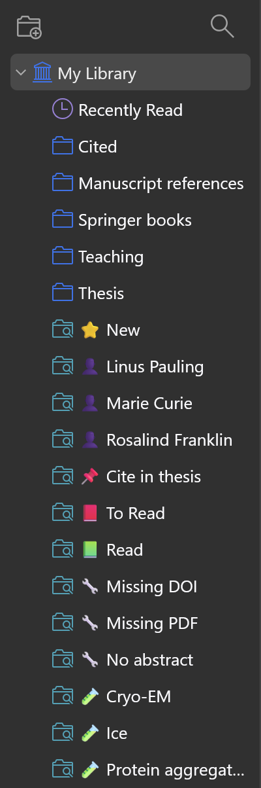
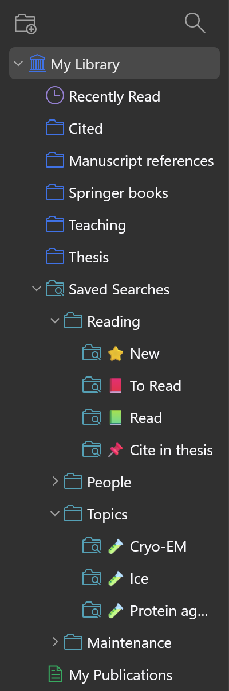
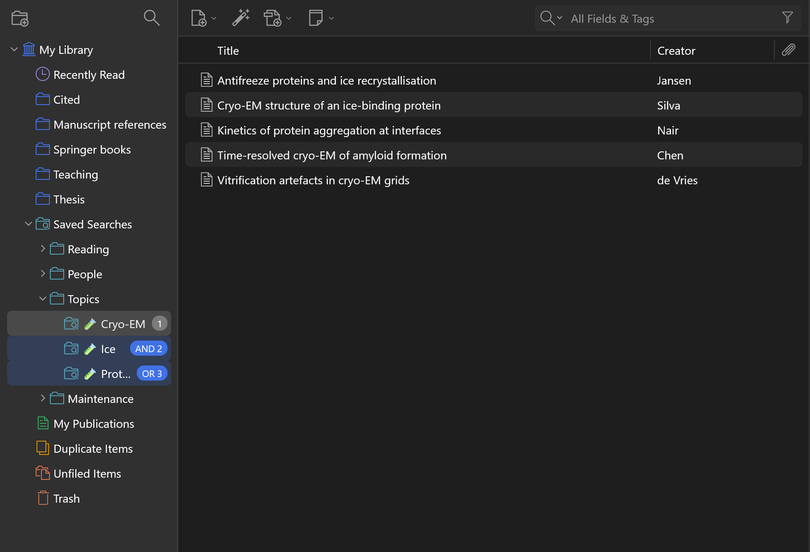
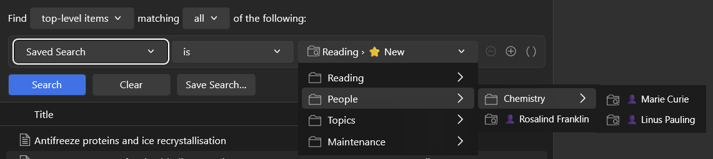

# Saved Search Folders for Zotero

Organise Zotero's saved searches into collapsible folders, put them in your own order, and
combine them on the fly with AND / OR. Everything is stored in the saved search names, so
it syncs everywhere and nothing breaks if you uninstall the plugin.

**Before** (left): every saved search in one flat list. **After** (right): one collapsible *Saved Searches* folder, with your own folders and order inside.

<p>
  
  &nbsp;&nbsp;
  
</p>

**Combining searches:** Ctrl+click adds a search with AND, and Shift+click adds one with OR. Here, *Cryo-EM* AND *Ice*, OR *Protein aggregation*:



**Your folders in Zotero's search conditions:** the *Saved Search is* menu follows the same folders and order:



Works with Zotero 10 (tested on 10.0.7). For Zotero 7–9, use [version 1.0](../../releases/tag/v1.0), which is the last version for those releases.

---

## Why this was made

Saved searches are one of Zotero's best features: a search builds a "smart collection" that
keeps itself up to date. But Zotero puts every saved search in one flat list in the left
pane, under your collections. People have asked for a way to organise them for a very long
time:

- One thread's title says the request is
  [almost 18 years old](https://forums.zotero.org/discussion/comment/476417/), and requests for
  [organising saved searches](https://forums.zotero.org/discussion/1027/) go back to at least 2012–2013.
- Users describe the list becoming [oppressive once you have many searches](https://forums.zotero.org/discussion/comment/490549/),
  and ask to [group and collapse them](https://forums.zotero.org/discussion/comment/469367/),
  [nest them](https://forums.zotero.org/discussion/76171/nesting-saved-searches/p1), or
  [put them in folders](https://forums.zotero.org/discussion/comment/300107/).
- The Zotero team has said it's planned, with no timeline. Meanwhile the common workaround is
  adding prefixes like `_Author_…` to names so related searches sort together.
- Combining two searches means building a third saved search with "Saved Search is …"
  conditions, which breaks if one of the originals is deleted.

**My own case:** I loved saved searches (new additions, reading status, the work of specific
people and research groups), but I couldn't keep them. They took over my entire left pane and pushed
my collections out of view. So I stopped using a feature I actually wanted.

### Design principle: stay inside what Zotero already does

I didn't want something that adds hidden databases, custom sync settings, or anything that
breaks when the plugin is gone or a colleague doesn't have it. So **the plugin only renames
saved searches** and draws the result as a tree:

| Saved search name | Shown as |
|---|---|
| `People/Marie Curie` | **People** › Marie Curie |
| `Reading/Archive/Old` | **Reading** › **Archive** › Old |
| `1_Reading/2_To Read` | **Reading** › To Read (the `N_` order prefix is hidden) |

Because of that:

- **It syncs** to your other computers and to group libraries through normal Zotero sync. Nothing extra to set up.
- **Removing the plugin breaks nothing.** You see the full names like `People/Marie Curie`, still
  sorted by folder and in your custom order, since `1_`, `2_` sort the same way in Zotero's own list.
- **Saved combinations are ordinary saved searches.** They contain the merged conditions (using
  Zotero 10's nested condition groups where needed) rather than references to other searches, so
  deleting one of the originals doesn't break them.
- The *Saved Searches* folder that holds everything is purely visual: it doesn't rename anything, so you can
  tidy up your left pane on day one, before organising a single search.
- The only thing stored locally is which folders are open, like Zotero does for collections.

---

## Features

- **One *Saved Searches* folder** (with the saved-search icon) holds all searches of a library, so collapsing it
  clears your left pane straight away. Nothing is renamed for this.
- **Folders and subfolders** for saved searches, opened and closed like collections. Folder icons are cyan,
  like saved-search icons, so you can tell them apart from collections.
- **Custom order:** drag searches and folders up and down, use *Move Up / Move Down* in the right-click menu, or type a `1_`, `2_` … prefix yourself.
- **Combine searches:** Ctrl+click (Cmd+click on macOS) adds a search with **AND**, and Shift+click adds one
  with **OR**. Badges (`1`, `AND 2`, `OR 3`) show what's combined, and the items list shows the result.
- **Save a combination** as a new, self-contained saved search, including mixes like `(A AND B) OR C`.
- **Drag and drop** to reorder, to move searches into folders, to nest folders, or onto *Saved Searches* to move to the top level.
  Dragging one of several Ctrl/Shift-clicked searches moves them all.
- **Renaming keeps the folder:** Zotero's search editor shows just the search's own name, and the folder and position are kept when you save.
- **A tidy *Saved Search is* menu:** in Zotero's search conditions, your folders appear as submenus, in your own order and without the `1_` prefixes.
- Works with the collection filter (the magnifier at the top of the left pane), in group libraries, and in read-only libraries (view only).

## Install

1. Download the latest `saved-search-folders-x.y.z.xpi` from [Releases](../../releases).
2. In Zotero, go to **Tools → Plugins**, click the gear icon, then **Install Plugin From File…**, and pick the `.xpi`.

## Usage

### Folders

| To… | Do this |
|---|---|
| Create a folder | Right-click *Saved Searches* or *My Library* (or a group) → **New Search Folder…**. Enter a name; a blank *Untitled* search is placed in it (a folder exists as long as it contains a search). Drag your searches in, then edit or delete *Untitled*. |
| Create a subfolder | Right-click a folder → **New Subfolder…** |
| Put a search in a folder | Drag it onto the folder, or right-click → **Move to Search Folder ▸** |
| New search in a folder | Right-click the folder → **New Saved Search in Folder…**. It's created blank and opens in Zotero's search editor. |
| Rename a search | Right-click → **Edit Saved Search**. The name field shows only the search's own name, and the folder and position are kept. Typing a full path such as `Other folder/Name` moves it there. |
| Move to the top level | Drag onto *Saved Searches* (or *My Library*), or **Move to Search Folder ▸ (Top level)** |
| Move several searches at once | Ctrl/Shift-click them, then drag any of them |
| Rename, ungroup or trash a folder | Right-click the folder |
| Open or close a folder | Click it |

### Order

**Drag** a search or folder onto another row. A blue line shows where it lands:

- **Search rows:** top half = above, bottom half = below. Dropping next to a search in another folder moves it into that folder at that spot.
- **Folder rows:** top quarter = above the folder, bottom quarter = below it (or first inside it, if the folder is open), middle = into the folder.

Or right-click → **Move Up / Move Down**. Either way, that level gets numbered (`1_`, `2_`, …) behind the scenes.
**Sort Alphabetically** (folder menu, or the *Saved Searches* menu for the top level) removes the numbers again.
Numbered entries come first; un-numbered folders, then searches, follow alphabetically.

### Combining searches

1. Select a saved search.
2. **Ctrl+click** (macOS: **Cmd+click**) another search to combine with **AND**, or **Shift+click** to combine with **OR**.
   Ctrl/Shift+click a highlighted search again to remove it.
3. You can also right-click → **Add Saved Search with AND ▸ / OR ▸** to pick from a menu.
4. Right-click → **Save Combination as Saved Search…** creates the new search next to the first one and
   opens it in Zotero's search editor, so you can review and rename it. To discard it, delete it like any
   other search.

Zotero 10 has its own multi-select in the left pane, which shows everything from all selected rows. This
plugin only changes that for two saved searches, where Ctrl/Cmd+click means AND and Shift+click means OR.
Collections and libraries, and selections that start from one, keep Zotero's normal behaviour.

Clicking any other row ends the combination. Dragging one of the highlighted searches moves the whole
group (handy for filing several searches into a folder at once).

Combinations are evaluated left to right: `A AND B OR C` means `(A AND B) OR C`.

**When can a combination be saved as one self-contained search?** Almost always: any mix of AND and OR
is saved using nested condition groups. The exception is searches with different search-wide options
(the result level, or "Include parent and child items"), because those apply to a whole search. In that
case the plugin explains why and offers to save a search that *refers to* the originals instead, which
does depend on them. The live combined view itself is always exact.

## Options

To use a different folder separator than `/` (for example `»` or `::`), set this in
**Settings → Advanced → Config Editor**:

```
extensions.savedsearchfolders.separator
```

To number searches with something other than `_`, set this one, for example to `~`, so that `2~People` is
shown as *People*. This is useful if you have searches whose names really start with a number and an
underscore, like `2_Reasons`, since their `2_` would otherwise be hidden:

```
extensions.savedsearchfolders.orderSeparator
```

To show folders directly under *My Library* without the *Saved Searches* folder, set
`extensions.savedsearchfolders.rootFolder` to `false`.

Restart Zotero after changing these. They don't rename your existing searches, so any that use the old
separator appear with their full names until you rename them.

## Limitations

- Folder rows can't be selected, so keyboard arrows skip them.
- Searches can't be placed inside collections. This only organises the saved-search part of the tree.
- The plugin hooks into Zotero's internal collection tree, so a future Zotero version that changes it may require you to update the plugin.

## License

[MIT](LICENSE)
